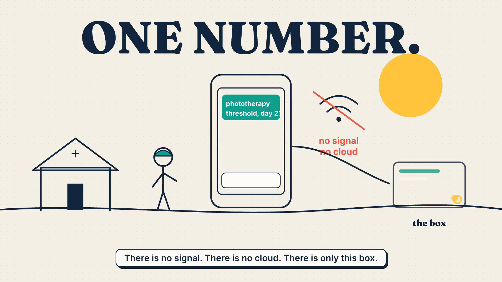
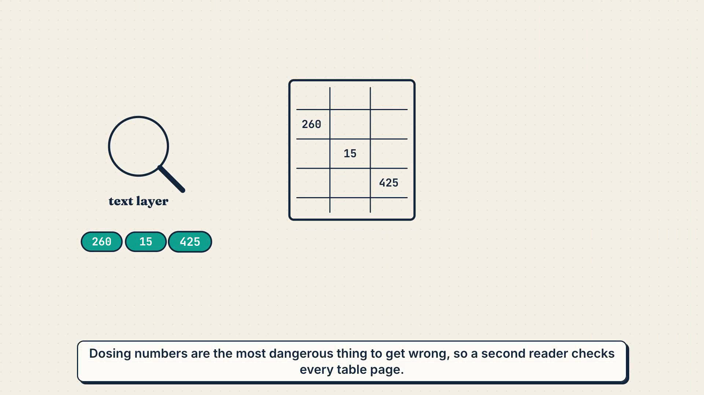
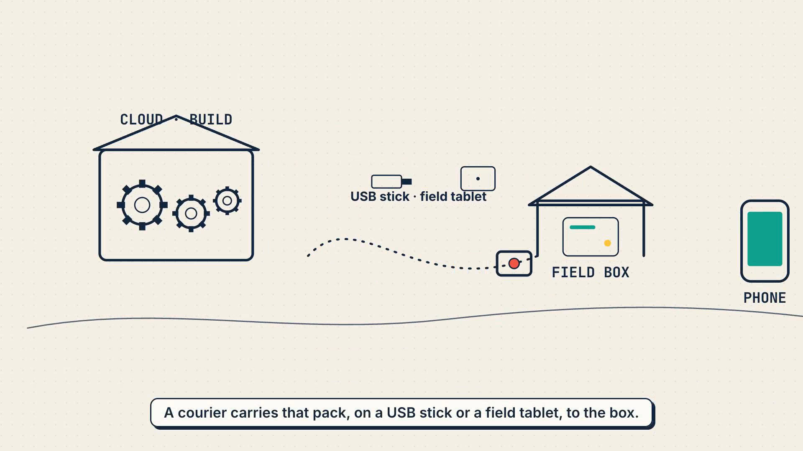
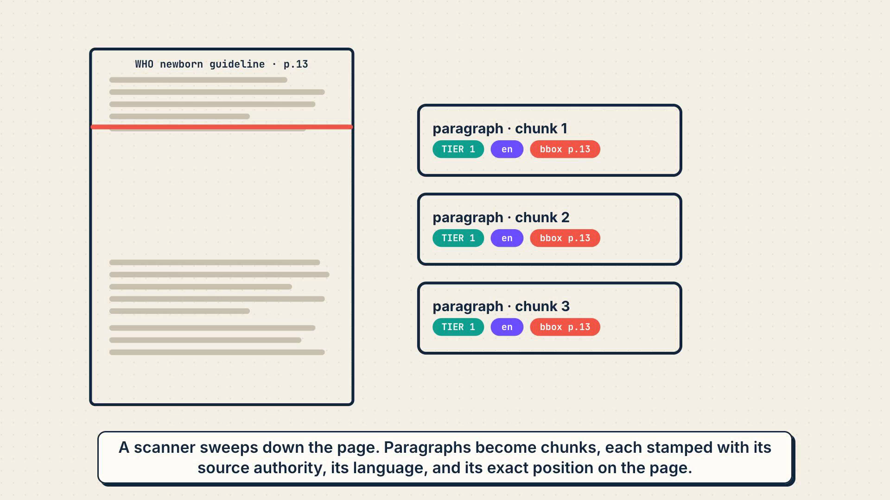
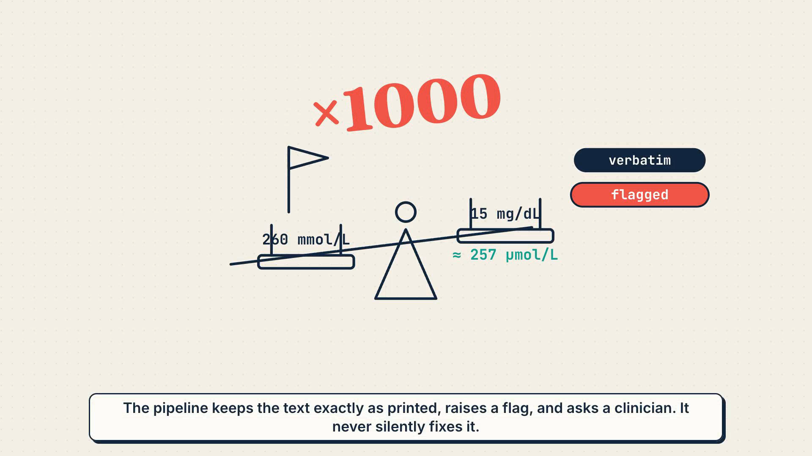
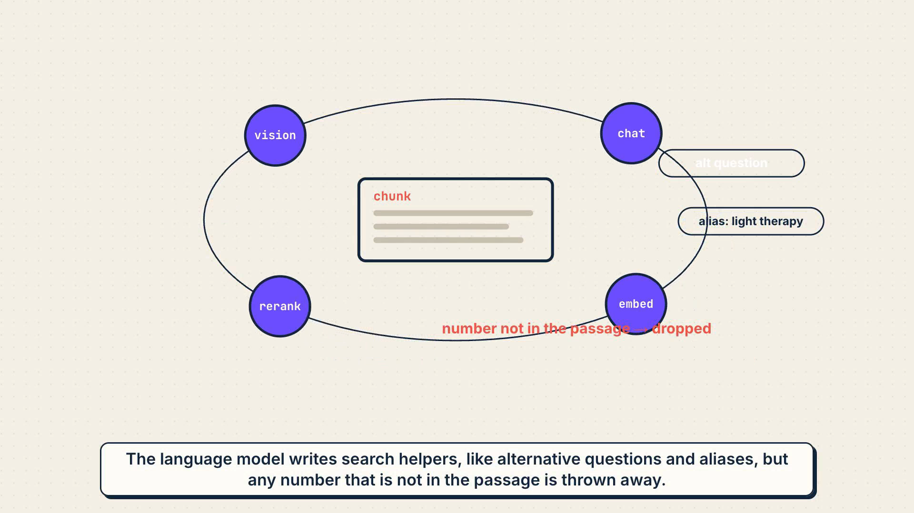

# CMES-AI
Ai integration in CMES

> **Mission:** Offline-first clinical reference assistant for field health workers in low-connectivity regions. Every answer cites its source or honestly says "not found".

[]()
[](https://github.com/sai009/offline-medical-qa)
[]()

---

## 📄 System Card

See [`System_Card_ProjectPolo-TWB.md`](System_Card_ProjectPolo-TWB.md) — TWB's system assessment for Project Polo / CMES evaluation in low-resource settings.

---

## ⚠️ CRITICAL SAFETY NOTICE

> **This system has NOT been validated for clinical decision-making. Deployment to field workers for patient-care decisions could result in serious harm or loss of life.**
>
> **PROHIBITED USE CASES:** Emergency triage • Primary clinical decision support • Pediatric/neonatal dosing without independent validation • Polypharmacy/interaction checking • Any use without supervising clinician verification

### Safety Documentation (Required Reading)

| Document | Purpose | Status |
|----------|---------|--------|
| [SAFETY.md](SAFETY.md) | **Clinical safety assessment** — regulatory gaps, prohibited use cases, 10 critical gaps, high-risk scenarios, minimum requirements checklist | ✅ Complete |
| [ARCHITECTURE_REVIEW.md](ARCHITECTURE_REVIEW.md) | **Technical architecture review** — RAG grounding mechanisms, LLM constrainment gaps vs. NotebookLM, 5 missing verification layers, recommended additions with code sketches | ✅ Complete |
| [docs/03-safety-rules.md](docs/03-safety-rules.md) | **8 Non-negotiable safety rules (SR-01 to SR-08)** — code locations, gate enforcement, amendment process | ✅ Draft Complete |

**All contributors must read SAFETY.md and ARCHITECTURE_REVIEW.md before making changes.**

---

## 📋 Project Status: **Early Migration — Phase 0 Complete**

This repository is a **phased migration** of the working TWB v1.1 prototype into a production-ready, team-maintainable codebase.

**What exists today:**
- ✅ Phase 0: Problem Statement with architecture diagrams (`docs/00-problem-statement.md`)
- 📦 Source prototype: [offline-medical-qa@9e5f42d](https://github.com/sai009/offline-medical-qa/commit/9e5f42d) — 31/31 tests passing, full pipeline implemented

**What's coming (per phased plan):**
- Phase 1: Architecture decisions & frozen contracts (NEW WORK)
- Phases 2–7: Copy working implementation from prototype (NO REWORK)
- Phase 8: Hardware benchmarks (requires procurement)
- Phase 9: CI/CD & release engineering (NEW WORK)
- Phase 10: Clinical validation (NEW WORK — hard blocker)

---

## 🗓️ Phase Tracker (Source of Truth)

| Phase | Title | Status | Type | Target |
|-------|-------|--------|------|--------|
| **0** | [**Problem Statement**](https://github.com/sai009/CMES-AI/blob/main/docs/00-problem-statement.md) | ✅ **Done** | New work | Week 1 |
| **1** | Architecture & Contracts | ⏳ Planned | New work | Week 2 |
| **2** | Ingestion Pipeline | ✅ **Done** | **Copy from prototype** | Week 3 |
| **3** | Enrichment Pipeline | ✅ **Done** | **Copy from prototype** | Week 3 |
| **4** | Indexing & Packing | ✅ **Done** | **Copy from prototype** | Week 4 |
| **5** | Edge Runtime | ✅ **Done** | **Copy from prototype** | Week 4 |
| **6** | Evaluation Gates | ✅ **Done** | **Copy from prototype** | Week 4 |
| **7** | Test Console (UI) | ✅ **Done** | **Copy from prototype** | Week 4 |
| **8** | Benchmarks & Hardware | ⏳ Planned | New work + HW | Week 6–10 |
| **9** | CI/CD & Release Engineering | ⏳ Planned | New work | Week 6–8 |
| **10** | Clinical Validation | ⏳ Planned | **New work — blocker** | Week 4–12 |

> **Legend:** ✅ Done | 🔄 In Progress | ⏳ Planned | ❌ Blocked
> **Type:** "Copy from prototype" = code exists in source repo, just needs migration. "New work" = must be built from scratch.

---

## 📁 Current Repository Structure (Reality)

```
CMES-AI/
├── README.md                          # This file
├── System_Card_ProjectPolo-TWB.md     # TWB system assessment (keep untouched)
├── LICENSE                            # MIT
├── docs/                              # Phase 0 + safety + architecture diagrams
├── ingest/                            # Phase 2: PDF→chunks, zero LLM
├── enrich/                            # Phase 3: NIM enrichment (optional)
├── indexer/                           # Phase 4: SQLite FTS5 + HNSW + Ed25519 signing
├── edge/                              # Phase 5: stdlib HTTP server + updater
├── eval/                              # Phase 6: 8 fail-closed gates + golden sets
├── common/                            # Shared: NIM, units, lang, http, util
├── pipeline/                          # Pipeline orchestrator
├── src/                               # Phase 7: UI (index.html, compare.html, DESIGN.md) + edge/server.py
├── tests/                             # Phase 7: ui_smoke.mjs + unit tests
├── benchmarks/                        # Phase 8: hardware benchmarks (script ready)
├── spec/                              # 📭 Empty (Phase 1)
├── scripts/                           # 📭 Empty (Phase 9)
├── golden/                            # 📭 Empty (Phase 10)
└── .github/workflows/                 # 📭 Empty (Phase 9)
```

> **Phases 0, 2–7 complete.** Source code copied from prototype (twb `mesh` branch @ `9928d3f`, from offline-medical-qa@9e5f42d). Phase 1 (contracts) and Phases 8–10 pending.

---

## 🔗 Source Prototype (What We're Migrating)

| Component | Source Location | Tests | Status |
|-----------|-----------------|-------|--------|
| Ingest (PDF→chunks, zero LLM) | `ingest/ingest.py` | 27 unit | ✅ Working |
| Enrich (NIM chat, optional) | `enrich/enrich.py` | 4 NIM mock | ✅ Working |
| Indexer (SQLite+FTS5+HNSW+sign) | `indexer/build_pack.py` | Included | ✅ Working |
| Edge Runtime (stdlib+ONNX+SSE) | `edge/core.py`, `edge/server.py` | Included | ✅ Working |
| Gates (8 fail-closed) | `eval/gates/run_gates.py` | Included | ✅ Working |
| Pipeline Orchestrator | `pipeline/run.py` | Included | ✅ Working |
| Test Console (/ui/) | `ui/` + server static | 12 UI smoke | ✅ Working |
| Benchmarks | `benchmarks/run_hardware_benchmarks.py` | — | Script ready |
| Setup Scripts | `setup.py`, `setup.sh`, `setup.ps1`, `setup.bat` | — | ✅ Working |

**All 31 tests pass on the prototype.** Migration = copy + restructure, not rewrite.

---

## 🏗️ Architecture at a Glance (from Phase 0)

### System Overview: Cloud Build → Edge Runtime

| Cloud (Build-Time Only) | Transport | Edge (Runtime) |
|-------------------------|-----------|----------------|
|  | Signed Pack (USB / WiFi / Sneakernet) |  |

```mermaid
flowchart LR
    subgraph CLOUD["☁️ CLOUD (Build-Time Only)"]
        BUILDER["Builder Machine"]
        NIM["NVIDIA NIM API"]
        PDF["Source PDFs"]
        BUILDER --> PDF
        BUILDER --> NIM
    end

    subgraph EDGE["📱 EDGE DEVICE (Runtime)"]
        SERVER["Edge Server (stdlib)"]
        ONNX["ONNX Models"]
        UI["Test Console (/ui/)"]
        SERVER --> ONNX
        SERVER --> UI
    end

    BUILDER -->"Signed Pack (USB/WiFi)"| EDGE
```

**Key principle:** Cloud = build-time only. Edge = runtime, fully offline.

### Build Pipeline (What Happens in the Cloud)

| Stage | Frame | Description |
|-------|-------|-------------|
| **1. Ingest (Zero LLM)** |  | pdfplumber extracts text + tables; custom geometry resolves headers, merged cells, bboxes; second-reader vision verify |
| **2. Enrich (Optional NIM)** | — | NIM chat model writes search helpers (aliases, alt questions); numbers not in passage discarded |
| **3. Index & Sign** |  | NIM embed → HNSW vectors + SQLite FTS5; 8 fail-closed gates; Ed25519 signature chain (Root → CI) |

### Runtime Flow (What Happens on the Edge)

| Step | Frame | Description |
|------|-------|-------------|
| **Search & Rerank** |  | Dual search: BM25 (FTS5) + Vector (HNSW/ONNX embed) → Cross-encoder rerank (ONNX) → Abstain if below threshold |
| **Table-First Answer** | — | Tables returned verbatim; matching cell highlighted with row/col headers; verifier checks every number in source |
| **Test Console** |  | `/ui/` served by edge: Ask / Build / Gates / Update tabs; dev banner; disclaimer on every screen |

### Core Promise

| Frame | Description |
|-------|-------------|
|  | **Cite, or abstain.** Every answer cites source or says "not found". Zero generated doses. Verifiable, safe, offline-first. |

---

## 📚 Documentation Index (Living)

| Document | Phase | Status |
|----------|-------|--------|
| [Problem Statement](docs/00-problem-statement.md) | 0 | ✅ **Complete** — clinical problem, users, constraints, 3 Mermaid diagrams |
| [Architecture Decisions](docs/01-architecture-decisions.md) | 1 | ⏳ Planned — ADR log, frozen contracts |
| [Requirements](docs/02-requirements.md) | 1 | ⏳ Planned |
| [Safety Rules](docs/03-safety-rules.md) | 1 | ✅ **Draft Complete** — 8 non-negotiable rules (SR-01 to SR-08) with code locations |
| **Safety Assessment** | — | ✅ **Complete** — [SAFETY.md](SAFETY.md) — 10 critical gaps, prohibited use cases, min requirements |
| **Architecture Review** | — | ✅ **Complete** — [ARCHITECTURE_REVIEW.md](ARCHITECTURE_REVIEW.md) — 5 missing verification layers, code sketches |
| [Production Readiness](docs/04-production-readiness.md) | 9+ | ⏳ Planned |

---

## 🛣️ Roadmap Visual

```
Phase 0 ──────► Phase 1 ──────► Phases 2-7 ──────► Phase 8/9 ──────► Phase 10 ──────► Pilot
  ✅              ⏳              ⏳ (copy)            ⏳              ⏳ (blocker)    📅
Problem         Contracts       Implementation      Infra + HW      Clinical      Field
Statement       Frozen          (from prototype)    CI/CD           Validation    Pilot
```

**Critical path items (start Day 1):**
1. **Clinical recruitment** (Phase 10) — 2 clinicians for golden set + tier sign-off
2. **Hardware procurement** (Phase 8) — NVIDIA Jetson Orin Nano / Pi 5 + NVMe HAT (4–6 wk lead)

---

## 🤝 How to Contribute

1. Check the **Phase Tracker** above for available work (phases 1, 8, 9, 10 are open)
2. Phases 2–7 code is already migrated from the prototype — review and test
3. Phases 1, 9, 10: design first, then implement
4. Open PR: `Phase N: <title>`
5. Update this README's phase tracker on merge

Maintainer: [sai009](https://github.com/sai009) (volunteer, Techies Without Borders)

---

## 📄 License

MIT

---

## 🔗 References

- **Prototype Repo:** [offline-medical-qa](https://github.com/sai009/offline-medical-qa) (private — source of Phases 2–7 code)
- **Prototype Commit:** `9e5f42d` — v1.1 complete, 31/31 tests passing
- **Architecture Spec:** [ARCHITECTURE.md](https://github.com/sai009/offline-medical-qa/blob/main/ARCHITECTURE.md)
- **Handoff Doc:** [HANDOFF_DOCUMENTATION.md](https://github.com/sai009/offline-medical-qa/blob/main/HANDOFF_DOCUMENTATION.md) (ADR-1)

---

*Last updated: Phases 0, 2–7 complete. Repository contains Phase 0 docs + Phases 2–7 code (ingest, enrich, indexer, edge, eval, common, pipeline, UI, tests) copied from offline-medical-qa@9e5f42d (twb `mesh` branch). Phase 1 (contracts) and Phases 8–10 pending.*
