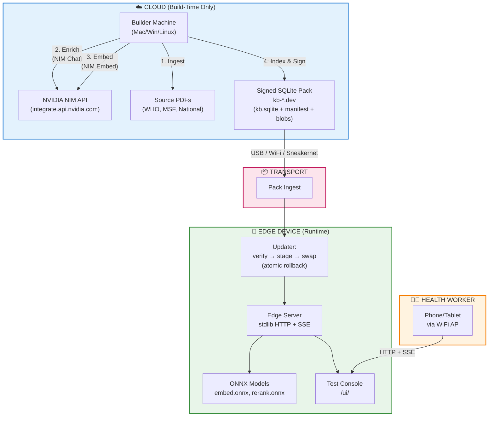
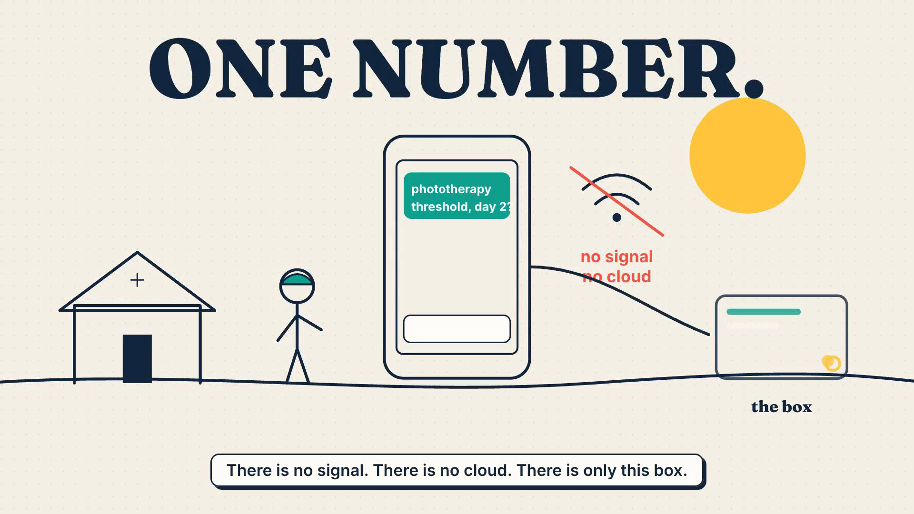
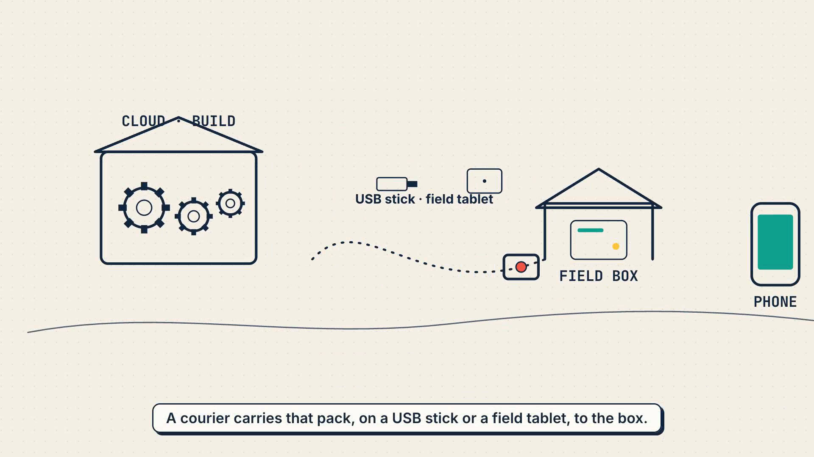
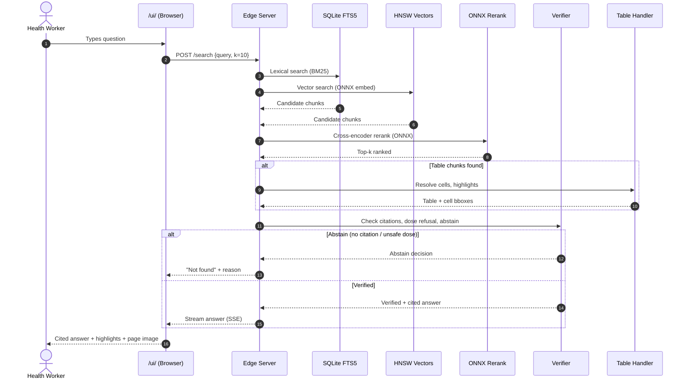
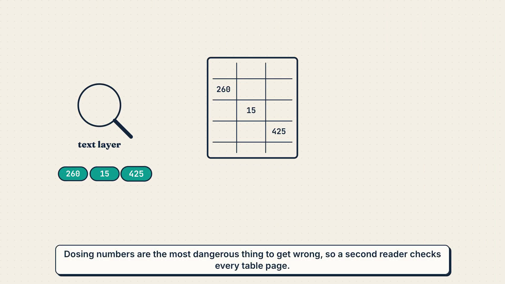
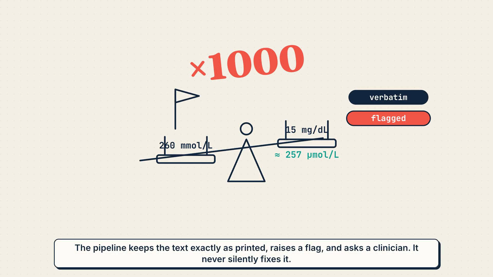
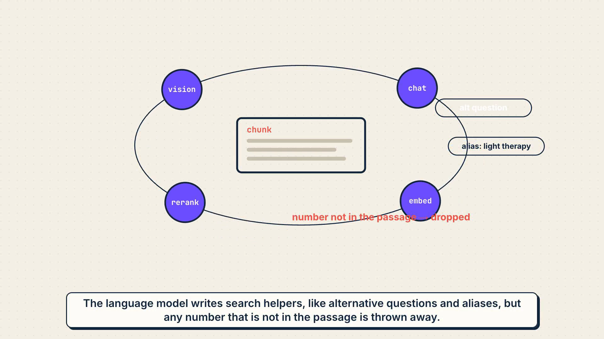

# Problem Statement: Offline Clinical Reference Assistant

**Document Version:** 1.0  
**Status:** DRAFT — For Review  
**Owner:** Product Manager + Clinical Lead  
**Last Updated:** 2025-01-28

---

## 1. Clinical Problem

### 1.1 Core Need
Field health workers (nurses, clinical officers, community health workers) in low-connectivity regions need **instant, reliable clinical answers** at the point of care — without internet access.

### 1.2 Current Reality
- **No internet** in many facilities (rural clinics, mobile outreach, humanitarian settings)
- **Outdated paper references** — WHO guidelines, national protocols, drug formularies are often years old
- **No decision support** — workers rely on memory or guesswork for dosing, protocols, danger signs
- **Language barriers** — English guidelines, local language patients
- **High stakes** — wrong dose = death; missed danger sign = death

### 1.3 Target Users
| User Type | Setting | Connectivity | Clinical Training |
|-----------|---------|--------------|-------------------|
| Nurse / Clinical Officer | Rural health center | None / intermittent | 2–3 years |
| Community Health Worker | Village / household | None | 6–12 weeks |
| Midwife | Birth center / home visits | None | 1–2 years |
| Medical Officer | District hospital | Limited | 5–6 years |

---

## 2. Target Deployment Context

### 2.1 System Architecture Overview

*Figure: Cloud build pipeline (left) produces signed packs transported via USB/WiFi to edge device (right) which serves answers fully offline.*

### 2.2 Hardware Constraints
- **Edge device:** Single-board computer (NVIDIA Jetson Orin Nano / Raspberry Pi 5 + NVMe)
- **Power:** Solar + battery (target < 10W average)
- **Storage:** 64–256 GB NVMe / SD (must hold pack + OS + logs)
- **Display:** Optional touchscreen (7–10") or headless (phone via WiFi AP)
- **Network:** Local WiFi AP only (no WAN); USB sneakernet for updates

### 2.3 Environmental Constraints
- Temperature: 0–40°C (fanless preferred)
- Dust/humidity: IP54+ enclosure
- Power interruptions: Daily (must boot < 30s, resume instantly)
- Physical: Portable, ruggedized, theft-resistant

### 2.4 Operational Constraints
- **No cloud dependency at runtime** — ever
- **Updates via signed packs** — USB, local WiFi, or sneakernet
- **No patient data stored** — no PII, no telemetry, no analytics
- **Multi-language UI** — English + Swahili + French + Portuguese (Phase 2+)
- **Training time:** < 30 minutes for basic use

---

## 3. Pipeline Flow (Build-Time)

```mermaid
flowchart LR
    subgraph STAGE1["Stage 1: Ingest (Zero LLM)"]
        PDF["Source PDFs\n(samplefiles/)"]
        PLUMBER["pdfplumber\nText + Tables"]
        GEOMETRY["Custom Geometry\nHeaders, Merged Cells, BBox"]
        CHUNKS["Chunks + Tables\n(build/ingest/)"]
        VERIFY["Second-Reader\nVerify"]
    end

    subgraph STAGE2["Stage 2: Enrich (Optional NIM)"]
        CHUNKS2["Chunks"]
        NIM_CHAT["NIM Chat Model\n(meta/llama-3.1-70b-instruct)"]
        ENRICHED["Enriched Chunks\nAcronyms, Defs, Dosage\n(build/enrich/)"]
        CACHE["Enrichment Cache\nCost Control"]
    end

    subgraph STAGE3["Stage 3: Index & Pack"]
        ENRICHED2["Enriched Chunks"]
        EMBED["NIM Embed Model\n(nvidia/llama-3.2-nv-embedqa-1b-v2)"]
        VECTORS["HNSW Vectors"]
        FTS5["SQLite FTS5"]
        MANIFEST["Manifest.json\nModel IDs, Counts, Git SHA"]
        GATES["8 Fail-Closed Gates\n(fail-closed semantics)"]
        SIGN["Ed25519 Sign\nRoot → CI Chain"]
        PACK_OUT["Signed Pack\nkb-1.x.x-dev/"]
    end

    PDF --> PLUMBER --> GEOMETRY --> CHUNKS --> VERIFY
    VERIFY --> CHUNKS2
    CHUNKS2 --> NIM_CHAT --> ENRICHED
    NIM_CHAT -.->|"Optional\nOffline=Hash"| ENRICHED
    ENRICHED --> CACHE
    CACHE --> ENRICHED2
    ENRICHED2 --> EMBED --> VECTORS
    ENRICHED2 --> FTS5
    VECTORS --> MANIFEST
    FTS5 --> MANIFEST
    MANIFEST --> GATES --> SIGN --> PACK_OUT

    style STAGE1 fill:#e3f2fd,stroke:#1976d2,stroke-width:2px
    style STAGE2 fill:#fff3e0,stroke:#f57c00,stroke-width:2px
    style STAGE3 fill:#e8f5e9,stroke:#388e3c,stroke-width:2px
```

*Figure: Stage 1 extracts text and tables with full geometry (headers, merged cells, bounding boxes); Stage 3 runs 8 fail-closed gates and seals the pack with Ed25519 signature chain.*

---

## 4. Runtime Flow (Edge Device)

*Figure: Dual search (BM25 + HNSW) → cross-encoder rerank → abstain gate → table-first answer with cell highlights.*

---

## 5. Clinical Scope (MVP)

### 5.1 Included Domains
| Domain | Example Questions | Source Tier |
|--------|-------------------|-------------|
| **Emergency & Resuscitation** | "Propofol dose RSI adult", "Neonatal resuscitation steps", "Adrenaline dose anaphylaxis" | Tier 1 (WHO, ILCOR) |
| **Essential Medicines** | "Amoxicillin dose child 5kg", "Oxytocin for PPH", "Magnesium sulfate eclampsia" | Tier 1 (WHO EML) |
| **Maternal & Newborn** | "Active management 3rd stage", "Kangaroo mother care criteria", "Newborn danger signs" | Tier 1 (WHO MNH) |
| **Pediatric Emergencies** | "Ceftriaxone dose meningitis", "Quinine vs artesunate severe malaria", "ORS volumes" | Tier 1 (WHO Pocket Book) |
| **Trauma & Burns** | "Parkland formula", "Tourniquet time limits", "Tetanus prophylaxis" | Tier 2 (MSF, WHO) |

### 5.2 Explicitly OUT of Scope (MVP)
- Chronic disease management (HIV, TB, diabetes — separate programs)
- Surgical procedures beyond emergency basics
- Laboratory interpretation (requires lab integration)
- Patient-specific calculations (weight-based done via tables only)
- Telemedicine / referral coordination
- Training / education content (guidelines only)

---

## 6. Success Criteria (Measurable)

| Metric | Target | Measurement |
|--------|--------|-------------|
| **Answer latency (p99)** | < 2 seconds | On target hardware (N150/Pi5) |
| **Retrieval recall@10** | ≥ 90% | Against clinician golden set |
| **Citation coverage** | ≥ 95% | Answers with ≥1 verifiable citation |
| **Abstention accuracy** | Within 5% of clinician | Held-out calibration set |
| **Dose refusal rate** | 100% | Zero generated doses |
| **Table accuracy (WHO mmol/L)** | 100% flagged | Known anomaly detection |
| **Boot time (cold)** | < 30 seconds | Power-on to UI ready |
| **Pack update time** | < 60 seconds | Stage → apply → verify |
| **Rollback time** | < 1 second | Atomic swap |
| **Uptime (30 days)** | > 99.5% | No manual intervention |

---

## 7. Constraints & Assumptions

### 7.1 Hard Constraints (Non-Negotiable)
1. **Offline-first** — Zero external network calls at runtime
2. **Cite or abstain** — Every answer must cite source or say "not found"
3. **No generated doses** — Tables verbatim; summaries refuse dose questions
4. **Atomic updates + rollback** — Signed packs, instant revert
5. **No PII / telemetry** — Zero patient data, zero usage analytics
6. **Disclaimer on every screen** — "Not a substitute for clinical judgment"

### 7.2 Technical Assumptions
- PDF corpus: ~50–200 source documents (WHO, national guidelines, formularies)
- Pack size: < 500 MB (SQLite + vectors + page images)
- Build frequency: Monthly (new guidelines) → quarterly (stable)
- Model updates: Explicit, versioned, tested before deploy
- Edge inference: ONNX Runtime (CPU/GPU), no PyTorch/TensorFlow on device

### 7.3 Regulatory Assumptions
- **Not a medical device** — clinical reference only, no diagnosis/treatment decisions
- **IEC 62304 Class A** — if reclassified, re-evaluate
- **Data residency** — All data stays in-country; no cross-border transfer
- **Local approval** — Ministry of Health sign-off required per country

---

## 8. Stakeholders

| Role | Interest | Decision Authority |
|------|----------|-------------------|
| **Ministry of Health** | National deployment, policy alignment | Go/No-Go for country rollout |
| **Clinical Lead (2x)** | Content accuracy, golden set, tier sign-off | Gate 1, 3, 6 pass criteria |
| **Field Supervisors** | Usability, workflow integration | UI/UX acceptance |
| **Biomedical Engineers** | Hardware procurement, maintenance | Hardware spec sign-off |
| **IT / Data Officers** | Security, updates, compliance | Update channel approval |
| **Funding Partner** | Budget, timeline, milestones | Phase gate funding |

---

## 9. Risks to Problem Definition

| Risk | Impact | Mitigation |
|------|--------|------------|
| Scope creep (add chronic diseases) | Delays MVP, bloats pack | Freeze scope at Phase 1 sign-off; Phase 2+ for extensions |
| Clinician disagreement on tiers | Blocks golden set | Pre-defined tier definitions; tie-break by Clinical Lead |
| Hardware unavailable | Blocks Phase 8 | Dual-track: simulate on desktop GPU; order Day 1 |
| Local language requirements | UI complexity | English-only MVP; i18n framework in Phase 2 |
| Regulatory reclassification | Requires redesign | Monitor WHO/IMDRF guidance; design for Class A from start |

---

## 10. Prototype Evidence (Frames from Working System)

| Frame | Description |
|-------|-------------|
|  | **Test Console (`/ui/`):** Ask tab shows cited answer, highlighted table cells, source page with cited region boxed; Build/Gates/Update tabs for engineers. |
|  | **Core Promise:** "Cite, or abstain." Verifiable, safe, offline-first for those who cannot wait for a signal. |

---

## 11. References

- WHO Pocket Book of Hospital Care for Children (2013/2020)
- WHO Essential Medicines List (2023)
- WHO Managing Complications in Pregnancy and Childbirth (2017)
- ILCOR Consensus on CPR/ECC (2020)
- MSF Clinical Guidelines (2022)
- National Standard Treatment Guidelines (per country)
- [CMES-AI Safety Rules](../03-safety-rules.md) — 8 non-negotiable rules (SR-01 to SR-08)

---

**Next Step:** Review with Clinical Lead + Product Manager → Sign off → Freeze scope → Proceed to Phase 1 (Architecture & Contracts)